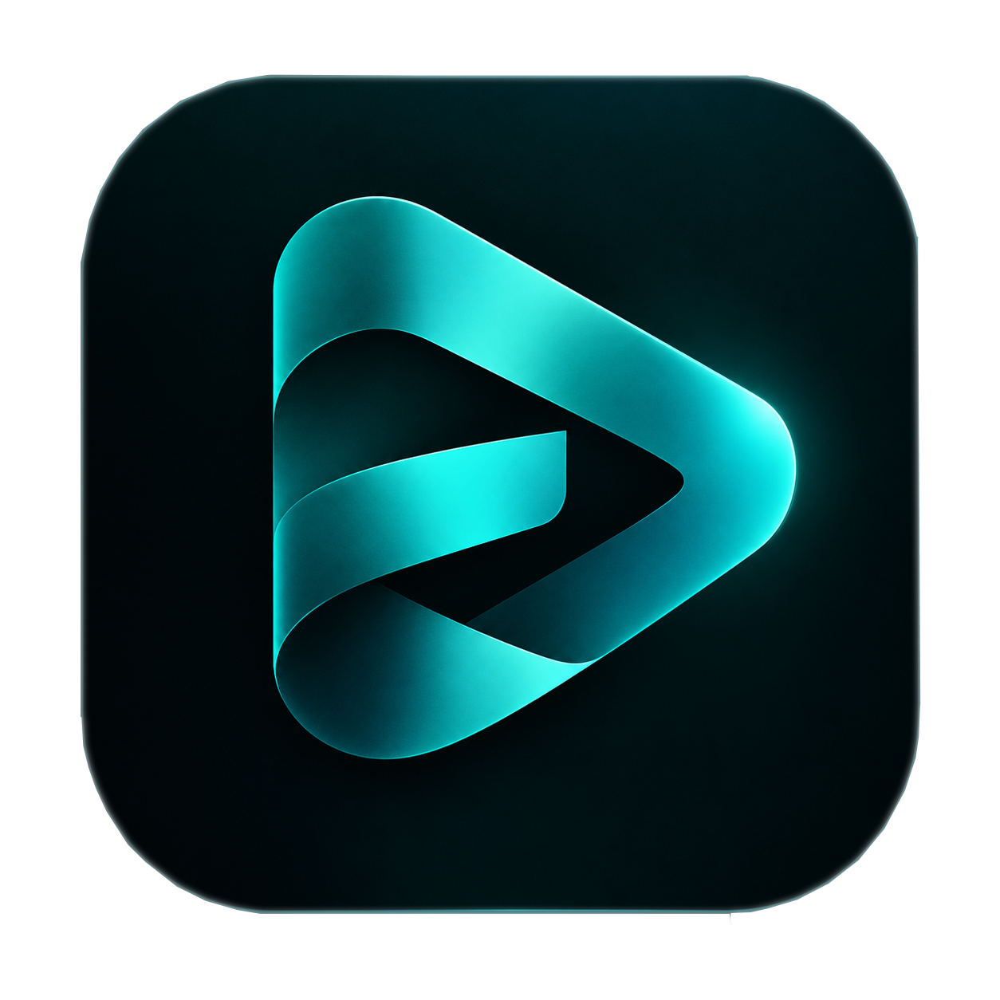

<div align="center">



# E R U &nbsp; C I N E M A &nbsp; · &nbsp; エ ル ミ

**Cinema-Grade Desktop Streaming Platform for Movies & TV Shows**

[](https://electronjs.org/)
[](https://react.dev/)
[](https://vitejs.dev/)
[](https://tailwindcss.com/)
[](https://microsoft.com/windows)
[](LICENSE)

---

*Inspired by [Erumi Android App](https://github.com/jhudel26/Erumi-Android-App) · Reimagined for Desktop Cinema Experience*

</div>

---

## Screenshots

<div align="center">

### Main Interface & Cinema Catalog


</div>

---

## Overview

**ERU Cinema** is a cinema-grade standalone desktop application engineered specifically for streaming **Movies** and **TV Shows** with a modern high-contrast **Teal** aesthetic (`#00e5bc`), glassmorphic panels, and smooth animations.

Unlike anime-specific applications, **ERU** focuses on western and international cinema, blockbuster movies, trending series, and episodic television shows powered by dynamic discovery and multi-server streaming backends.

---

## Features

- **Teal Cinema UI/UX**:
  - Deep noir background (`#081114`) with glowing teal neon accents (`#00e5bc`, `#14f4c9`).
  - Glassmorphic translucent cards, ambient backdrop lighting, and smooth hover micro-interactions.
  - Prominent unboxed brand logo with glowing dropshadow and frameless native window controls.

- **Full-Bleed Cinematic Splash Screen**:
  - App-matched 1320x840 startup sequence with ambient brand glow and cinema backdrop.
  - Dynamic progress lifecycle with real-time status indicators and guaranteed 100% completion handshake.
  - Seamless zero-flicker transition into the main cinema interface.

- **Digital Availability Filtering**:
  - Automatically filters out movies that are only in movie theaters or have no digital/physical release yet.
  - Excludes unreleased TV shows and unaired seasons, ensuring titles in the catalog are streamable.
  - Real-time catalog powered by TMDB integration with local caching.

- **Cinema Player Experience**:
  - Full-screen and theater mode player with frameless HUD controls.
  - Redundant multi-server fallback switcher directly inside the player bar.
  - Integrated Season & Episode Drawer for TV Series (switch episodes without leaving the video player).
  - Next / Previous episode shortcuts and instant stream reload (`R` key).

- **Ad-Block & Security Layer**:
  - Process-level webRequest interception blocking invasive ad networks, popunders, and redirect scripts.
  - Automatic `X-Frame-Options` and `Content-Security-Policy` header rewriting for seamless embed playback.

- **Watchlist & History**:
  - Local persistent **Watchlist** to bookmark movies and series.
  - Continuous **Watch History** tracking recently played media and episode numbers.

---

## Tech Stack

| Layer | Technology |
|---|---|
| **Runtime** | Electron 45 (Chromium + Node.js) |
| **UI Framework** | React 19 |
| **Styling** | Tailwind CSS 3.4 |
| **Bundler** | Vite 8 |
| **Icons** | Lucide React |
| **Installer** | Inno Setup 6 |

---

## Getting Started

### Prerequisites
- Node.js 18+ (tested on Node v24/v26)
- npm 9+
- Windows 10 / 11 (64-bit)

### Installation
```bash
git clone https://github.com/jhudel26/Eru_Movies.git
cd Eru_Movies
npm install
```

### Optional: TMDB API Key Configuration
The app includes a built-in fallback configuration for discovery and metadata. To use your own TMDB API key:
1. Copy `.env.example` to `.env`:
   ```bash
   cp .env.example .env
   ```
2. Edit `.env`:
   ```env
   TMDB_API_KEY=your_api_key_here
   ```

### Run in Development (with Hot Reloading)
```bash
npm run dev
```

### Build Production Bundle
```bash
npm run build
```

### Launch Built Desktop Application
```bash
npm start
```

---

## Building the Installer (Inno Setup)

ERU Cinema uses **Inno Setup 6** for compiling lightweight, high-compression standalone setup packages.

Ensure Inno Setup 6 is installed on your system at `C:\Program Files (x86)\Inno Setup 6\ISCC.exe`, then run:

```bash
npm run installer
```

This single command will:
1. Build the production React client (`vite build`).
2. Package the Electron executable into `release/win-unpacked`.
3. Compile the Inno Setup script (`installer.iss`) with `lzma2/ultra64` solid compression.
4. Output the final installer to `release/installer/ERU_Cinema_Setup_v1.0.0.exe`.

---

## Project Structure

```
Eru_Movies/
├── electron/
│   ├── main.js             # Electron main process, window management, ad-block, IPC
│   ├── preload.js          # ContextBridge secure APIs
│   ├── scrapers.js         # Unified catalog orchestrator
│   ├── tmdb.js             # TMDB API client with digital availability filtering & cache
│   ├── vidy.js             # Multi-server embed resolver
│   └── splash.html         # Application startup splash screen
├── public/
│   ├── icon.ico            # Windows application icon
│   └── icon.png            # High-resolution logo
├── src/
│   ├── assets/             # Brand graphics & icons
│   ├── components/
│   │   ├── TitleBar.jsx          # Custom frameless title bar with search & controls
│   │   ├── Sidebar.jsx           # Modern navigation drawer
│   │   ├── HeroBanner.jsx        # Cinema hero banner with auto-carousel
│   │   ├── MediaCard.jsx         # Glassmorphic poster card with rating & badges
│   │   ├── MediaGrid.jsx         # Category filter pills & responsive media grid
│   │   ├── MediaDetailModal.jsx  # Rich details sheet with seasons & server list
│   │   ├── PlayerView.jsx        # Cinema player mode with multi-server switcher
│   │   └── SettingsModal.jsx     # User preferences & history manager
│   ├── services/
│   │   ├── api.js                # Frontend IPC abstraction layer
│   │   └── storage.js            # LocalStorage persistence manager
│   ├── App.jsx             # Main application orchestrator
│   ├── index.css           # Custom Teal theme & glassmorphic styles
│   └── main.jsx            # React root entry
├── docs/
│   └── screenshots/        # Application interface previews
├── installer.iss           # Inno Setup 6 installation script
├── vite.config.mjs         # Vite bundler configuration
└── package.json            # Scripts & dependencies
```

---

## Disclaimer

This project is created for **educational and research purposes only**. ERU Cinema does not host, store, or distribute any media files or copyright-protected content. All streams and metadata are indexed and fetched dynamically from public external providers.

---

## License

This project is licensed under the MIT License. See [LICENSE](LICENSE) for details.
