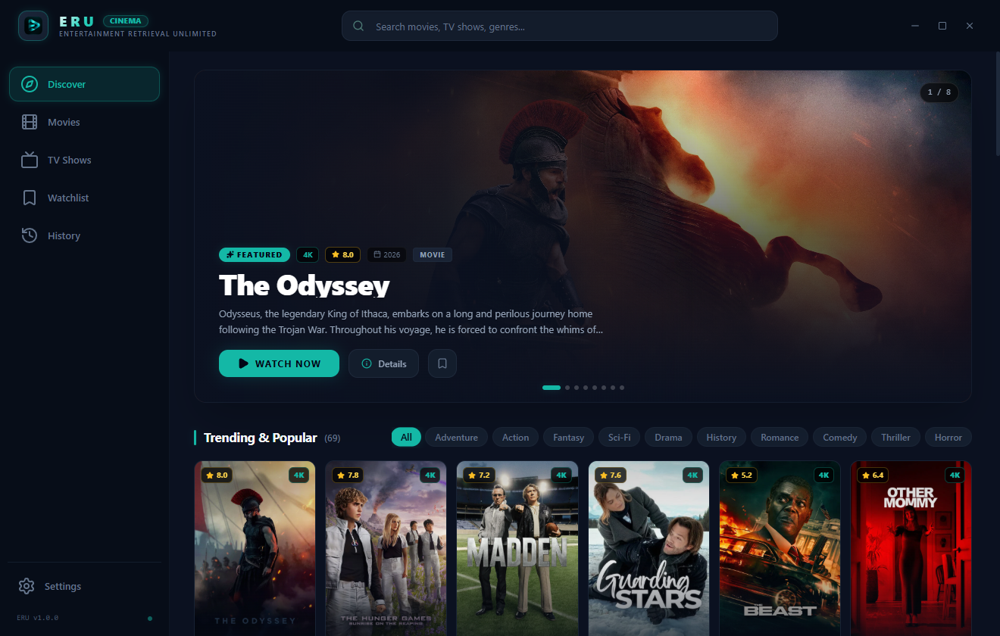

# ERU Cinema

Desktop streaming application for movies and television series, built with Electron, React, and Tailwind CSS.



---

## Overview

ERU Cinema is a dedicated desktop media browser and player for Windows. It provides a unified interface for browsing trending, popular, and top-rated movies and TV shows, complete with rich metadata, seasonal episode navigation, multi-source stream resolution, and integrated ad-blocking.

---

## Key Features

- **Curated Catalog & Digital Availability Filtering**: 
  - Dynamic discovery powered by TMDB integration.
  - Automatic filtering excludes theatrical-only movies and unaired television shows to present only titles with digital streaming availability.
- **Dedicated Player HUD**:
  - Full-screen cinema player with custom HUD controls.
  - Multi-server fallback switching directly inside the player interface.
  - Embedded Season & Episode navigation drawer for episodic TV series.
  - Keyboard shortcuts (`Esc` for fullscreen/exit handling, `R` for stream reload).
- **Ad and Popup Interception**:
  - Process-level webRequest interception blocking tracking networks, third-party redirects, and invasive ad scripts.
  - Seamless embed playback with automatic header policy adaptation.
- **Local Persistence**:
  - Offline watchlist bookmarks and persistent watch history.
  - Configurable user settings (autoplay preferences, stream filtering, data reset).
- **Windows Integration**:
  - Frameless modern window design with responsive window controls.
  - Custom Inno Setup installer script with Start Menu and Desktop shortcuts.

---

## Tech Stack

| Layer | Technology |
|---|---|
| Runtime | Electron 45 (Chromium + Node.js) |
| UI Framework | React 19 |
| Styling | Tailwind CSS 3.4 |
| Bundler | Vite 8 |
| Icons | Lucide React |
| Installer | Inno Setup 6 |

---

## Getting Started

### Prerequisites

- Node.js 18.0 or higher
- npm 9.0 or higher
- Windows 10 / 11 (64-bit)

### Installation

Clone the repository and install dependencies:

```bash
git clone https://github.com/jhudel26/Eru_Movies.git
cd Eru_Movies
npm install
```

### Environment Configuration (Optional)

The application includes a built-in fallback configuration for discovery and metadata. To use your own TMDB API key:

1. Copy `.env.example` to `.env`:
   ```bash
   cp .env.example .env
   ```
2. Set your API key:
   ```env
   TMDB_API_KEY=your_api_key_here
   ```

---

## Development

Run the Vite development server and Electron client concurrently:

```bash
npm run dev
```

Run Vite build only:

```bash
npm run build
```

Run Electron using the production build:

```bash
npm start
```

---

## Building the Installer

ERU Cinema uses Inno Setup 6 to compile standalone Windows setup packages.

### Automated Build (Recommended)

Ensure Inno Setup 6 is installed on your system at `C:\Program Files (x86)\Inno Setup 6\ISCC.exe`, then run:

```bash
npm run installer
```

This single command:
1. Compiles the React application via Vite.
2. Packages unpacked Electron binaries into `release/win-unpacked`.
3. Runs the Inno Setup compiler (`ISCC.exe`) against `installer.iss`.
4. Outputs the finished installer to `release/installer/ERU_Cinema_Setup_v1.0.0.exe`.

---

## Project Structure

```
.
├── electron/
│   ├── main.js             # Electron main process, window management, ad filtering, IPC
│   ├── preload.js          # Secure context bridge definitions
│   ├── scrapers.js         # Unified media catalog and scraper orchestrator
│   ├── tmdb.js             # TMDB API client with digital availability filters and caching
│   ├── vidy.js             # Stream resolver and embed URL generator
│   └── splash.html         # Application startup splash screen
├── public/
│   ├── icon.ico            # Windows application icon
│   └── icon.png            # High-resolution raster asset
├── src/
│   ├── components/
│   │   ├── HeroBanner.jsx        # Featured spotlight carousel
│   │   ├── MediaCard.jsx         # Poster card with ratings and release information
│   │   ├── MediaDetailModal.jsx  # Detailed metadata sheet and episode picker
│   │   ├── MediaGrid.jsx         # Category filter pills and responsive media grid
│   │   ├── PlayerView.jsx        # Cinema player mode with multi-server switcher
│   │   ├── SettingsModal.jsx     # User preferences and storage manager
│   │   ├── Sidebar.jsx           # Main navigation drawer
│   │   └── TitleBar.jsx          # Custom frameless title bar
│   ├── services/
│   │   ├── api.js                # Frontend IPC communication layer
│   │   └── storage.js            # Local storage persistence manager
│   ├── App.jsx             # Root layout and view controller
│   ├── index.css           # Global theme styling
│   └── main.jsx            # React application entry
├── installer.iss           # Inno Setup 6 installation script
├── package.json            # Scripts and project dependencies
└── vite.config.mjs         # Vite bundler configuration
```

---

## Disclaimer

This project is created for educational and research purposes. ERU Cinema does not host, upload, or store media files on its servers. All catalog metadata and streaming links are retrieved dynamically from public third-party services.

---

## License

This project is licensed under the MIT License. See [LICENSE](LICENSE) for details.
